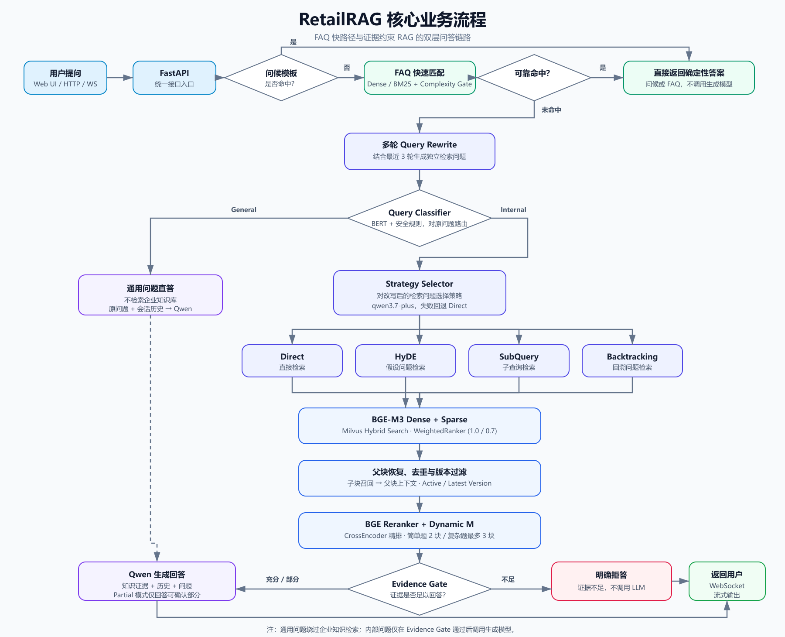
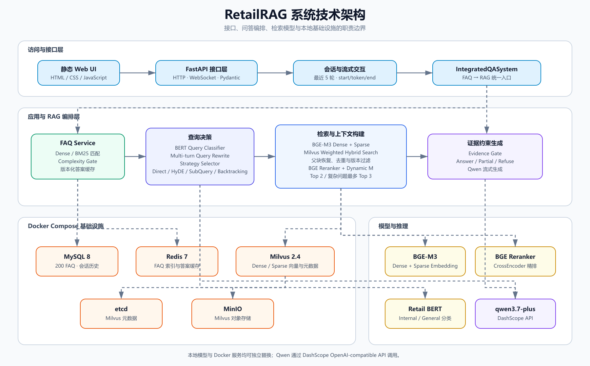

<div align="center">

# RetailRAG

### 连锁零售企业内部知识问答系统

面向门店员工的企业知识问答工程原型：以 **FAQ 快路径**处理高频确定性问题，\
以**证据约束 RAG**覆盖制度、会员、促销、售后、商品与门店运营等长尾问题。


</div>

---

## 项目简介

连锁零售企业的知识通常分散在门店 SOP、会员制度、促销通知、退换货规则、商品管理和内部制度中。员工遇到具体业务问题时，需要在多份文档与不同版本之间反复查找，也容易把过期规则当作当前规则。

RetailRAG 将结构化 FAQ 与 Retrieval-Augmented Generation 组合为分层问答系统：高置信 FAQ 直接返回；其余问题进入查询改写、意图分类、策略路由、Dense + Sparse 混合检索、父块恢复、Reranker 和 Evidence Gate，最终由 Qwen 基于检索证据生成回答。通用问题会绕过企业知识检索，直接交给模型处理。

> 仓库使用自建的 **Nova Retail 模拟企业数据**，用于 RAG 工程实践与评测，不代表真实企业规则，也不是生产部署。

## 核心业务流程



流程图对应当前真实调用链：FAQ 在 RAG 之前执行；Query Classifier 区分 `general` 与 `internal`；只有内部问题进入四种检索策略和 Evidence Gate。证据不足时系统直接拒答，不调用生成模型。

可编辑源文件：[retailrag-business-flow.svg](docs/assets/diagrams/retailrag-business-flow.svg)

## 系统技术架构



应用层由 FastAPI、FAQ Service 与 RAG 编排组成；MySQL、Redis、Milvus、MinIO 和 etcd 由 Docker Compose 管理。本地 BGE-M3、BGE Reranker 与 Retail BERT 承担检索侧推理，`qwen3.7-plus` 通过 DashScope OpenAI-compatible API 调用。

可编辑源文件：[retailrag-technical-architecture.svg](docs/assets/diagrams/retailrag-technical-architecture.svg)

## 核心技术实现

| 模块 | 解决的问题 | 方案与能力 |
|---|---|---|
| **1. FAQ + RAG 分层问答** | 高频固定问题不应每次进入长链路生成 | FAQ 默认使用 BGE-M3 Dense 匹配，并支持切换 BM25；达到阈值且通过 Complexity Gate 时直接返回，否则回退 RAG。MySQL 保存 200 条问答，Redis 缓存索引与版本化答案。 |
| **2. Dense + Sparse 混合检索** | 仅语义或仅关键词检索都容易漏召回 | BGE-M3 同时生成 Dense 与 Sparse 表示，Milvus 分路检索后使用 `WeightedRanker(1.0, 0.7)` 融合候选。 |
| **3. 父子分块与文档恢复** | 小块利于召回，但直接生成容易缺少完整语境 | 文档先切父块、再切子块；Milvus 召回子块后按 `parent_id` 恢复父块，并按父块内容去重。 |
| **4. Reranker 与上下文选择** | 初召回排序不足以直接作为生成上下文 | BGE Reranker 对“问题—父块”重新打分；默认选择 Top 2，复杂问题通过 Dynamic M 最多扩展到 Top 3，并兼顾文档多样性。 |
| **5. 查询分类与四种策略** | 不同复杂度的问题需要不同检索表达 | Retail BERT 与安全规则区分通用/内部问题；内部问题由 Strategy Selector 在 Direct、HyDE、SubQuery、Backtracking 之间选择，策略调用失败时回退 Direct。 |
| **6. 多轮对话与查询改写** | “那退货呢”一类追问缺少独立检索语义 | MySQL 保留最近 5 轮会话；有历史时，系统结合最近 3 轮将追问改写为独立检索问题，再执行策略选择与检索。 |
| **7. Evidence Gate 与版本约束** | 相关文本不一定足以回答，旧版本规则也可能造成误导 | 检索阶段过滤非生效文档并按版本组选择当前版本；Evidence Gate 结合 Reranker 分数与问题范围风险决定 Answer、Partial 或 Refuse。 |
| **8. FastAPI + WebSocket** | 长链路生成需要可交互的端到端演示 | FastAPI 提供会话、查询、历史、来源和健康接口；WebSocket 以 `start → token → end` 事件流返回生成结果。 |

该系统具备显式的查询决策与检索策略编排，但不是通用 Tool Calling Agent，也未使用 LangGraph 或 MCP。

## 项目评测与效果

正式结果来自冻结文件 [RETAILRAG_QWEN37_FINAL_METRICS.json](docs/evaluation/RETAILRAG_QWEN37_FINAL_METRICS.json) 与 [RETAILRAG_QWEN37_FINAL_EVALUATION_REPORT.md](docs/evaluation/RETAILRAG_QWEN37_FINAL_EVALUATION_REPORT.md)，统一使用 `qwen3.7-plus`，最终结论为 **GOOD_WITH_LIMITATIONS**。

| 数据规模 | 数量 | 数据规模 | 数量 |
|---|---:|---|---:|
| FAQ | 200 | 零售知识文档 | 80 篇 |
| FAQ 评测 | 480 | 检索评测 | 235 |
| Generation 评测 | 80 | Full RAG 评测 | 350 |

| 核心指标 | 正式结果 | 评测口径 |
|---|---:|---|
| **Retrieval Recall@3** | **90.11%** | 235 条检索评测 |
| **Retrieval MRR** | **0.8774** | 235 条检索评测 |
| **FAQ F1** | **86.36%** | 480 条 FAQ 评测；Precision 100%，Recall 76% |
| **Generation Faithfulness** | **98.13%** | 独立的 80 条生成评测，不属于 Full RAG 350 指标 |
| **Generation Answer Relevance** | **98.63%** | 独立的 80 条生成评测 |
| **Evidence Gate F1** | **97.83%** | 105 条证据门控制集 |
| **Full RAG Strict Accuracy** | **79.14%** | 350/350 成功执行，Execution Error 为 0 |

已有消融结果显示，提升均来自冻结实验，不是估算值：

| 对照实验 | 优化前 | 优化后 |
|---|---:|---:|
| Hybrid → Hybrid + Reranker：Recall@3 | 87.41% | 90.11% |
| Hybrid → Hybrid + Reranker：MRR | 0.8538 | 0.8774 |
| Query Rewrite：Hit@3 | 40.00% | 100.00% |
| Query Rewrite：MRR | 0.3500 | 0.8722 |

Full RAG 350 的严格判定分布为：Correct 229、Partial 43、Incorrect 9、Correct Refusal 48、Wrong Refusal 21。当前主要瓶颈是 FAQ Routing、Evidence Gate 和多文档完整召回，详见正式评测报告。

## 项目目录

```text
RetailRAG/
├─ app.py                              # FastAPI、HTTP 与 WebSocket 入口
├─ new_main.py                         # FAQ / RAG / 会话集成层
├─ base/                               # 配置、日志与查询复杂度分析
├─ mysql_qa/                           # MySQL、Redis、FAQ 检索与初始化
├─ rag_qa/
│  ├─ core/                            # 分类、策略、检索、Prompt 与 RAG 主流程
│  ├─ data/                            # 8 个业务域、80 篇模拟零售知识文档
│  ├─ document_loaders/                # PDF / Word / PPT / 图片解析与 OCR
│  ├─ text_splitters/                  # 中文与 Markdown 分块
│  ├─ classify_data/                   # Retail 查询分类数据集
│  └─ models/retail-query-classifier/  # BERT 分类器（权重使用 Git LFS）
├─ scripts/                            # 初始化、入库、分类器与公开验证脚本
├─ static/                             # 演示 Web UI
├─ docs/
│  ├─ assets/diagrams/                 # README 图表与可编辑 SVG 源文件
│  └─ evaluation/                      # 正式评测报告与汇总指标
├─ docker-compose.yml                  # 本地基础设施编排
└─ RETAILRAG_PHASE6_EVIDENCE_GATE_CONFIG.json  # 运行期 Evidence Gate 配置
```

## 快速启动

### 1. 环境要求

- Python 3.10（正式迁移验证在 Windows 环境完成）
- Git LFS
- Docker Desktop / Docker Compose
- 可用的 DashScope API Key
- 可容纳 BGE-M3 与 BGE Reranker 的本地磁盘空间；CPU 可运行，但初始化与推理更慢

### 2. 获取项目并安装依赖

```powershell
git clone https://github.com/genpichong769/RetailRAG.git
Set-Location RetailRAG
git lfs install
git lfs pull

python -m venv .venv
.\.venv\Scripts\Activate.ps1
python -m pip install --upgrade pip
python -m pip install -r requirements.txt
```

`requirements.txt` 默认引用 Windows 依赖快照；macOS 可改用 `requirements-mac.txt`。

### 3. 配置环境变量

```powershell
Copy-Item .env.example .env
```

在本地 `.env` 中填写 DashScope、MySQL 与 MinIO 凭据。`.env` 已被 Git 忽略，不要提交真实 Key 或密码。BGE-M3 与 BGE Reranker 默认按模型 ID 下载到 Hugging Face 缓存，也可通过 `BGE_M3_PATH`、`BGE_RERANKER_PATH` 指向已有目录。

### 4. 启动基础设施

```powershell
docker compose up -d
docker compose ps
```

该 Compose 启动 MySQL 8、Redis 7、Milvus 2.4、MinIO 与 etcd。

### 5. 初始化 MySQL、FAQ 与 Milvus

```powershell
python scripts/init_mysql.py
python scripts/init_faq.py
python scripts/init_milvus.py
python scripts/ingest_knowledge_base.py --replace
```

`init_mysql.py` 创建 FAQ 与会话表并导入 200 条 FAQ；`init_faq.py` 刷新 FAQ 数据及 Redis 命名空间缓存；`ingest_knowledge_base.py --replace` 会重建 Milvus Collection，仅应在首次初始化或确认需要重建时执行。

### 6. 启动 FastAPI

```powershell
python -m uvicorn app:app --host 127.0.0.1 --port 8003
```

| 服务 | 地址 |
|---|---|
| Web 演示页面 | [http://127.0.0.1:8003/](http://127.0.0.1:8003/) |
| FastAPI 文档 | [http://127.0.0.1:8003/docs](http://127.0.0.1:8003/docs) |
| 进程健康检查 | [http://127.0.0.1:8003/health](http://127.0.0.1:8003/health) |

## 当前验证情况与已知限制

正式报告记录的冻结实验结果如下；本次仓库整理没有重新调用付费模型，也没有改写冻结结果。

- FAQ 原问、FAQ 改写、单文档 RAG、多文档 RAG、版本冲突、无答案拒答、通用问题和多轮 Query Rewrite 场景已验证。
- MySQL、Redis、Milvus、MinIO、etcd、FastAPI、WebSocket 与浏览器端到端检查均记录为 `PASS`。
- 完整本地归档曾通过 84 个冻结输入文件的 SHA-256 基线检查；正式模型为 `qwen3.7-plus`。
- 当前是本地工程原型，不是经过生产环境验收的系统，`GET /health` 也只是进程级检查。
- 多文档检索仍是主要限制：Multi-document All Recall@3 为 67.74%，对应 Full RAG 多文档 Strict Accuracy 为 63.33%。
- 单 Uvicorn Worker 内仍包含同步、CPU 密集的检索/重排过程；长请求可能延迟并发健康检查与 WebSocket keepalive，不应据此宣称生产并发能力。
- Generation 80 与 Full RAG 350 均使用同一模型参与生成和裁判，评测可能偏乐观。

公开仓库提供不调用大模型的轻量校验：

```powershell
python scripts/verify_public_release.py
```

该脚本检查公开必需文件、200 条 FAQ、80 篇知识文档、分类器资产与 Git LFS 配置，并校验正式指标/报告的 SHA-256 和关键数值。逐题原始输出已从公开分支移出，因此该脚本不代表对 480 / 235 / 80 / 350 条样本的独立重算或对完整 84 文件基线的复验。

## 数据与安全边界

- FAQ、知识文档、企业名称和业务规则均为模拟数据。
- `.env`、运行日志、Docker 数据卷和上游模型缓存不会进入 Git。
- 正式分类器权重由 Git LFS 管理；BGE-M3 与 BGE Reranker 权重不随仓库分发。
- 公开仓库仅保留正式汇总指标与评测报告；逐题输出、阶段报告与旧版实验脚本保留在本地归档中。

---

<div align="center">

用于 RAG 技术实践、工程研究与技术面试展示。

</div>
